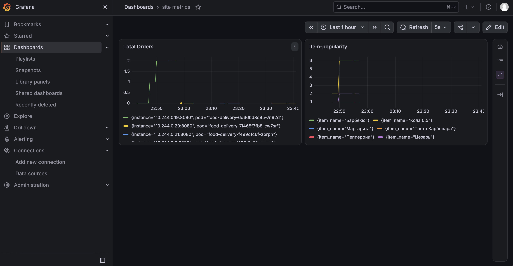
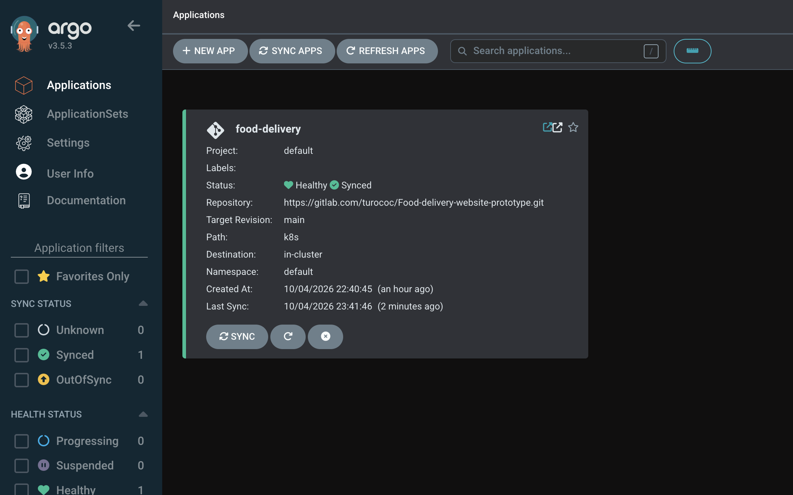
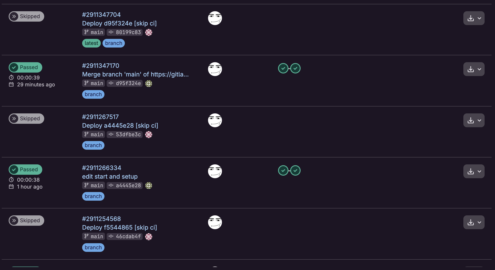

# Food Delivery: CI/CD и мониторинг в Kubernetes

Учебный DevOps-проект. Сайт доставки еды на Flask, который после `git push` автоматически собирается в Docker-образ, выкатывается в Kubernetes и отдаёт метрики, видимые в Grafana.

## Как это работает

```
git push → GitLab CI → Container Registry → Argo CD → Kubernetes → Prometheus → Grafana
```

1. **Push.** Код отправляется в GitLab.
2. **Сборка.** Пайплайн GitLab CI собирает Docker-образ и публикует его в Container Registry с тегом из хеша коммита.
3. **Обновление манифеста.** Этап `deploy` меняет тег образа в `k8s/deployment.yaml` и коммитит изменение обратно в репозиторий (с пометкой `[skip ci]`, чтобы не запускать пайплайн по кругу).
4. **Деплой.** Argo CD следит за папкой `k8s/` и сам применяет изменения в кластере (GitOps).
5. **Доступ.** Сайт открывается по адресу `http://cafe.local` через Ingress.
6. **Метрики.** Prometheus собирает метрики сайта с `/metrics` (через ServiceMonitor), Grafana рисует по ним графики.

## Стек

| Назначение | Инструмент |
|---|---|
| Приложение | Python, Flask, SQLite, gunicorn |
| Контейнеризация | Docker |
| CI | GitLab CI/CD, GitLab Container Registry |
| Деплой | Argo CD (GitOps) |
| Оркестрация | Kubernetes (minikube) |
| Мониторинг | Prometheus, Grafana (Helm-чарт kube-prometheus-stack) |

## Структура репозитория

```
.
├── argocd/               # описание приложения для Argo CD
├── delivery_service/     # приложение и Dockerfile
├── k8s/                  # манифесты Kubernetes (Deployment, Service, Ingress, ServiceMonitor, дашборд Grafana)
├── monitoring/           # манифесты prometheus
├── .gitlab-ci.yml        # пайплайн: сборка образа и обновление тега в манифесте
├── deploy.sh             # первичная настройка
├── start-kuber.sh        # запуск
└── Makefile              # короткие команды поверх скриптов
```

## Требования

- macOS (проверено). На Linux не тестировался.
- Docker Desktop. В настройках должно быть выделено хотя бы около 5 ГБ памяти (Settings → Resources).
- Установленные `minikube`, `kubectl`, `helm`. Если их нет, `deploy.sh` предложит поставить через Homebrew.

## Быстрый старт

Первая установка (make команды сделаны под macOS и чтобы они нормально работали у вас должны быть уже установлены все инструменты):

```bash
git clone https://gitlab.com/turococ/Food-delivery-website-prototype.git
cd Food-delivery-website-prototype
make setup
```

Скрипт запустит minikube, включит Ingress, поставит мониторинг и Argo CD и применит приложение. Первый запуск занимает несколько минут из-за скачивания образов.

запуск:

```bash
make start     # запуск кластера и проброс портов
make stop      # остановка
```

## Адреса

| Что | Адрес |
|---|---|
| Сайт | http://cafe.local |
| Grafana | http://localhost:3000 (логин `admin`) |
| Prometheus | http://localhost:9090 |
| Argo CD | https://localhost:8443 (логин `admin`) |

Пароль Grafana:

```bash
kubectl get secret monitoring-grafana -n monitoring -o jsonpath="{.data.admin-password}" | base64 -d; echo
```

Пароль Argo CD:

```bash
kubectl -n argocd get secret argocd-initial-admin-secret -o jsonpath="{.data.password}" | base64 -d; echo
```

## Метрики

Сайт отдаёт метрики на `/metrics`:

- `total_orders_total` — сколько заказов оформлено;
- `popular_items_total{item_name="..."}` — сколько порций каждого блюда заказано.

Примеры запросов в Prometheus:

```
sum(increase(total_orders_total[1h]))
topk(5, sum by (item_name) (increase(popular_items_total[1h])))
```

## Скриншоты



